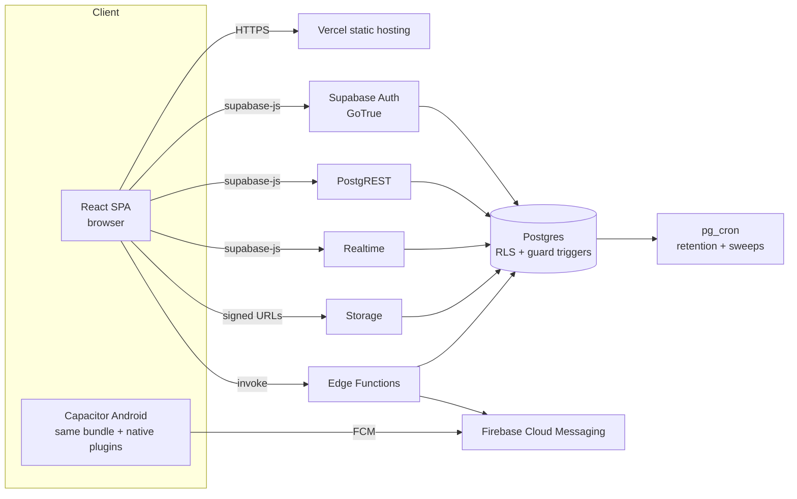

# MuntiCares — Architecture

Single-page web app with no application server. Supabase is the entire backend, and the Android app wraps the same web bundle in a Capacitor shell.

> The diagram below is Mermaid. If your viewer does not render Mermaid, the ASCII fallback and the prose in this document carry the same information.



```text
Browser / Capacitor Android
        |
        |  supabase-js (JWT from GoTrue)
        +--> Auth (GoTrue) ---------------+
        +--> PostgREST --> Postgres -----+--> pg_cron jobs
        +--> Realtime (broadcast,        |    (message expiry, call sweep,
        |    postgres_changes, presence) |     push-token prune, tracking expiry,
        +--> Storage (private buckets) --+     call-event prune)
        +--> Edge Functions (ice-servers, call-invite --> FCM)
```

## Components

### Client (`src/`)

React 18 + Vite. Role-gated routing in `src/App.jsx` (`ProtectedRoute` per role). State:
- `src/contexts/AuthContext.jsx` — session lifecycle. Role comes **only** from `public.users`; `user_metadata.role` is never trusted.
- `src/contexts/CallContext.jsx` — call state machine; `src/features/chat/hooks/useWebRTCCall.js` — native `RTCPeerConnection` with Supabase Realtime broadcast as the signaling relay.
- `src/contexts/PresenceContext.jsx` — typing/presence.
- Tracking services under `src/features/tracking/` call RPCs (`start_tracking_session`, `record_provider_location`, `mark_arrived`, ...).

### Supabase backend (`supabase/`)

- **Auth (GoTrue)** — email/password. A database trigger creates the `public.users` row on sign-up and a guard trigger blocks privilege-column changes.
- **Postgres + RLS** — every app table has RLS; row visibility is per-role (patient/provider/admin) with security-definer helper functions (`is_admin`, `is_my_counterpart`, `chat_attachment_is_participant`, ...) that pin `search_path`. Guard triggers enforce the request state machine (`guard_request_status`), provider column protection (`guard_provider_columns`), and trust-score computation.
- **Storage** — private buckets: `medical_documents`, `chat_attachments`. Chat media is served via short-lived signed URLs.
- **Realtime** — `postgres_changes` subscriptions for messages/requests/consent/announcements/locations; broadcast channels for WebRTC signaling; private `tracking:<uuid>` channels for live location.
- **Edge Functions**
  - `ice-servers` — mints short-lived TURN credentials per call (STUN-only fallback). Requires an authenticated user.
  - `call-invite` — wakes callee devices via FCM when a call rings. Re-verifies the caller and call state server-side.
- **pg_cron** — message 24h expiry (15 min), stale ringing-call sweep (1 min), stale tracking-session expiry (1 min), push-token prune (daily, 60 days), call-event prune (14 days).

### Data flows

1. **Auth** — sign-in returns a Supabase session; the client fetches the profile row from `public.users` to resolve the role; `ProtectedRoute` waits for the role before rendering dashboards.
2. **Service requests** — patient creates `requests` row → provider accepts/rejects → status transitions are guarded by `guard_request_status` (no downgrade from completed, etc.). Schedule slots are protected by a uniqueness index.
3. **Live tracking** — provider starts a tracking session (RPC), heartbeats write `provider_locations` with sequence numbers; the patient subscribes to the private tracking channel; the `mark_arrived` RPC enforces the geofence and deletes live locations on arrival. Sessions expire server-side.
4. **Chat** — messages insert via PostgREST under RLS; recipients receive them through `postgres_changes`; attachments upload to the private `chat_attachments` bucket and render via signed URLs; a cron job deletes messages older than 24 hours (call metadata in `calls`/`call_events` is retained).
5. **Teleconsultation** — caller creates a `calls` row ("ringing") and invokes `call-invite` → FCM push to the callee's devices; signaling (offer/answer/ICE) travels on a broadcast channel; each participant fetches TURN credentials from `ice-servers`; every signal/ICE step is appended to `call_events` for post-call diagnosis.
6. **Consent** — patient grants categories with expiry in `consent_access`; provider reads are filtered by `consent.js` (missing row / disabled / expired = no access), enforced server-side by RLS helpers and deny-by-default policies.

### Security notes

- RLS rollout (`20261102150000_rls_rollout_and_server_guards.sql`) revokes anon access, resets default privileges, and re-enables RLS with 32 policies.
- Edge-function secrets (TURN, Firebase) live in `supabase secrets set`, never in `VITE_*` env vars — anything prefixed `VITE_` ships in the browser bundle.
- No payments are collected or stored; the payments table was removed.

### Local development topology

- Vite dev server on `http://localhost:5173` (`npm run dev`, or `dev:https` for camera/WebRTC).
- `supabase start` for a local backend (Studio on 54323, Inbucket mail on 54324); the local DB schema comes from `supabase/migrations/`. There is no seed file — local data is whatever you create through the app.
- E2E specs (`tests/`) run against a dev server whose `VITE_SUPABASE_*` must match the E2E credential project.
